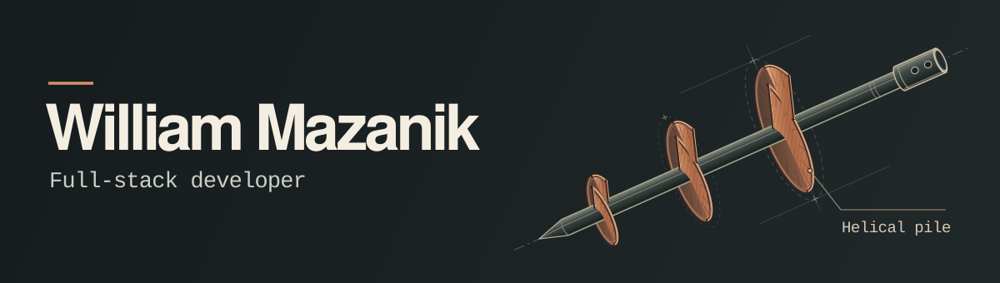
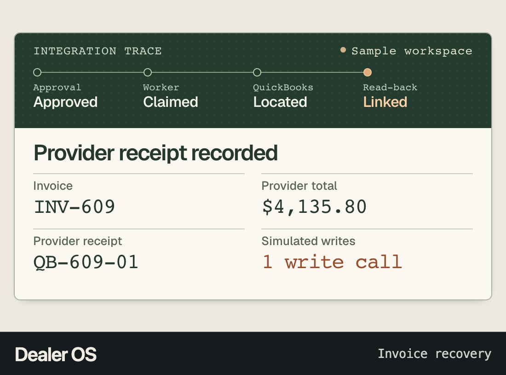
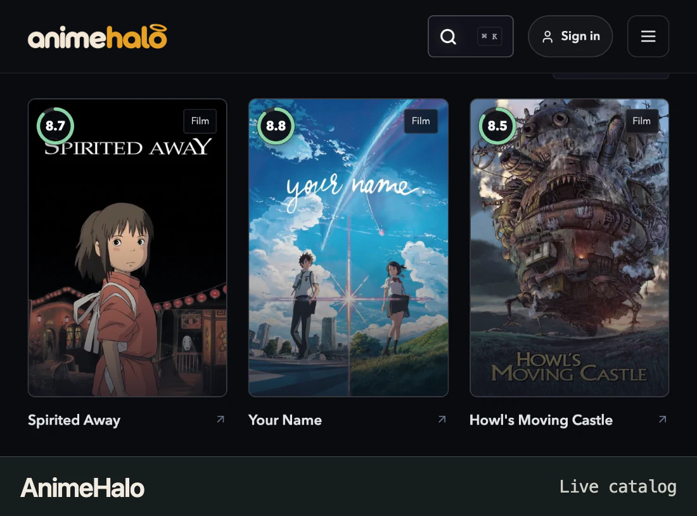

  

I write the software a helical pile dealer uses to schedule crews and bill jobs. I’m based in Innisfil, Ontario. Outside work, I run AnimeHalo, an anime and manga catalog.

  
  

**Dealer OS** · A lost reply from QuickBooks can leave a dispatcher wondering whether to send the invoice again. My recovery test reopens the SQLite journal and finds the original receipt after a restart. [Read the recovery test](https://github.com/yslarid/software-previews/blob/main/dealer-os.test.mjs#L75-L87)

**AnimeHalo** · Loading title details on demand brought the uncompressed startup catalog from 221 MB down to 4.3 MB. [Browse the catalog](https://animehalo.com/discover) · [Read the catalog tests](https://github.com/yslarid/software-previews/blob/main/animehalo.test.mjs#L60-L68)

**Jemparo** · I’m building tools for trade contractors. In CloseoutLink, a corrected repair gets a new receipt so the crew can still see what the first inspection found. [See how a correction is recorded](https://github.com/yslarid/software-previews/blob/main/closeout-receipts.test.mjs#L11-L30)

---

**Daily tools** `TypeScript` · `React` · `Node.js` · `PostgreSQL`

Previously at Arkwell Agency, I built WordPress sites for clients, including a clinic where I connected therapist profiles to appointment requests. BSc in Computer Science, Trent University.
